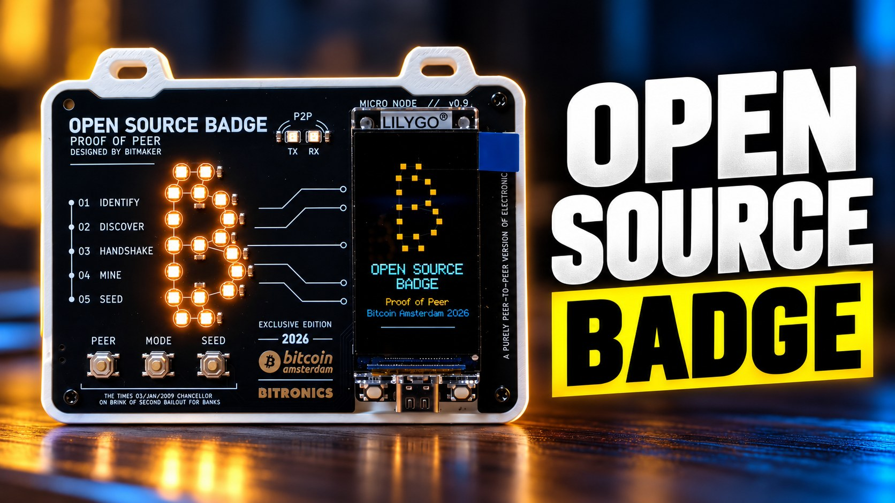

# Open Source Badge · Proof of Peer



The badge of **Bitcoin Amsterdam 2026**: a HAT with an 18 LED ₿, two TX/RX LEDs and three buttons
(PEER, MODE, SEED) on top of a LilyGO T-Display-S3 (ESP32-S3, 170x320 screen).

Designed by [Bitmaker](https://github.com/BitMaker-hub) · built by [Bitronics](https://bitronics.store)

## What it does

- **Proof of Peer.** Hold two badges together and press PEER on both: they swap contact cards (name, X,
  Telegram, npub, Lightning address and PGP fingerprint) over ESP-NOW, without internet. Badges close to each
  other see each other and send invites.
- **Zaps.** With a WiFi and your npub, the badge listens to Nostr zap receipts (damus, primal, nos.lol) and
  lights up the ₿ when you get one. Badges flashed for the event also carry their own LNbits wallet: its
  Lightning address is in the QR and every payment shows up at once.
- **NerdMiner.** Solo mining at ~140 kH/s with the hardware SHA-256 of the ESP32-S3, only while you look at
  its screen. Out of the box it mines on `pool.bitronics.store:3334`; put your own address in `badge.local`
  and the block is yours.
- **Seed Lab.** Learn how a BIP39 seed is born from dice or coin tosses (no chip RNG). Radio off while it
  runs. It is a learning tool: for real funds use an offline device such as the
  [Seeder](https://github.com/BitMaker-hub/Seeder).
- **badge.local.** Long press MODE: the badge opens the open WiFi `BADGE-xxx` and a setup page (profile,
  WiFi, npub, miner) with the list of people you met, downloadable as vCard or CSV.

## Buttons

| Button | Short | Long |
|---|---|---|
| **MODE** | Next page: profile, QR, peers, stats | Setup: WiFi `BADGE-xxx` and `badge.local` |
| **PEER** | Handshake with another badge | QR full screen (on STATS: withdraw) |
| **SEED** | LAB: Seed Lab or NerdMiner (SEED is always back) | Board test |

Holding SEED at power on also starts the board test: every LED in red, green and blue, the buttons, USB and
battery voltage, LED current and whatever is on the Qwiic port.

## Flash it

**From the browser:** [flasher.bitronics.store](https://flasher.bitronics.store), device *Open Source
Badge* (Chrome or Edge). Tick *Keep configuration* to update without losing your profile, wallet and peers.

**With esptool**, from the [latest release](https://github.com/BitMaker-hub/OpenSourceBadge/releases/latest):

```bash
esptool.py --chip esp32s3 write_flash 0x0 opensourcebadge-factory.bin
```

To update and keep the configuration, write only the application:

```bash
esptool.py --chip esp32s3 write_flash 0x10000 opensourcebadge-firmware.bin
```

| File | What it is |
|---|---|
| `opensourcebadge-factory.bin` | Bootloader, partitions and firmware in one image, at `0x0` |
| `opensourcebadge-firmware.bin` | Firmware only, at `0x10000` (keeps settings) |
| `opensourcebadge-firmware.elf` | Symbols, to read a crash dump |
| `SHA256SUMS.txt` | Hashes of the files above |

If the LEDs light up white at full power while flashing (old or broken firmware), hold BOOT while plugging
in USB, then press RST.

## Build from source

[PlatformIO](https://platformio.org):

```bash
pio run -t upload
pio device monitor
```

The version lives only in `platformio.ini` (`custom_version`) and is printed at boot and by the serial
command `i`, together with the commit.

**Release:** bump `custom_version`, commit, then tag and push:

```bash
git tag v1.0.0
git push origin v1.0.0
```

The [build workflow](.github/workflows/build.yml) compiles it, checks that the tag matches
`custom_version` and attaches the files to the release. The web flasher picks up new releases every day.

## Code map

```
src/
  main.cpp               the loop: buttons, state, LEDs and screen; serial commands
  config.h               pins and limits of the board (rev0.9)
  app/state_machine      what the badge does at each moment: start reading here
  app/badge, storage     profile, peers, sats; NVS and LittleFS
  app/seed_lab           BIP39 from dice or coin
  hardware/              buttons, LEDs (own RMT driver), power and battery, backlight, Qwiic
  effects/led_effects    LED effects for any group (the ₿, its outline, TX, RX)
  net/radio              who owns the radio: normal (WiFi + nearby) or exclusive
  net/peer_link, nearby  handshake and nearby badges over ESP-NOW
  net/nostr_zaps, lnbits zaps and wallet
  net/miner              wrapper of lib/nerdminer
  net/setup_portal       badge.local
  ui/                    display helpers, one function per screen, pixel art
lib/                     nerdminer (MIT), uBitcoin (MIT), qrcoded (MIT)
tools/                   screenshots over serial, logo and sprite export, event provisioning
```

Each state has one function that, on every loop, reads the buttons and decides the next state (`go()`),
lights its LEDs and draws its screen. Whatever a state does not light stays off.

The LEDs feed from the 3V3 regulator of the T-Display (600 mA, shared with the ESP32), so `leds::show()`
caps them at 200 mA.

## License

[MIT](LICENSE)
